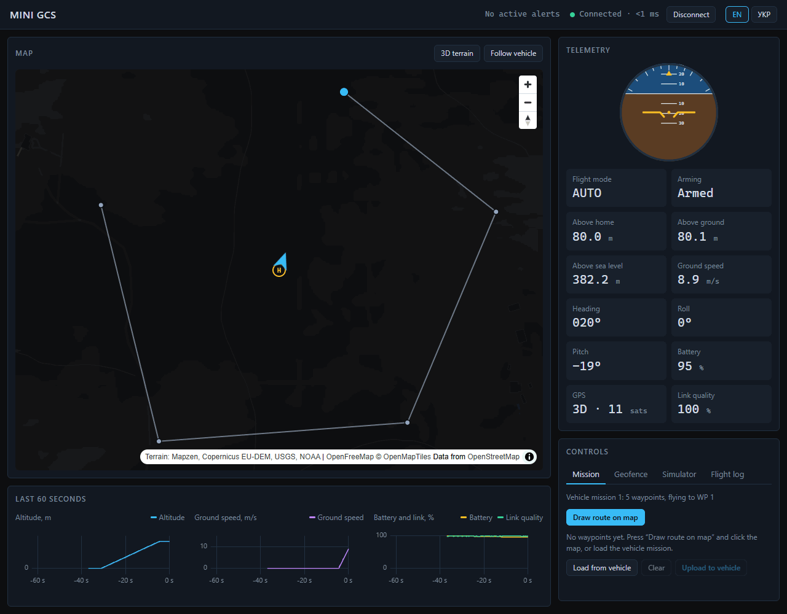

# Mini GCS

[](https://github.com/Nikita-Beliaiev/mini-gcs/actions/workflows/ci.yml)

A mini ground control station in the browser: a live map and telemetry dashboard for a simulated drone, built with React and TypeScript. It replays ArduPilot telemetry logs and, through a Python MAVLink bridge, flies ArduPilot SITL.

**Live demo:** https://nikita-beliaiev.github.io/mini-gcs/ ([in Ukrainian](https://nikita-beliaiev.github.io/mini-gcs/?lang=uk))



> **Status:** the planned roadmap is complete: live telemetry, mission planning, geofencing, alerts, charts, a WebSocket simulator, flight recording and replay, an English and Ukrainian interface, MAVLink log replay, a Python bridge to ArduPilot SITL, end-to-end and accessibility tests. Stretch goals are listed in the [Roadmap](#roadmap).
>
> All flights are simulated, by the station's own simulator or by ArduPilot SITL. The project is not meant to control real aircraft.

## Features

- Live map with vehicle position and heading, flight trail, home point and a follow-vehicle mode
- Telemetry panel with an attitude indicator: flight mode, arming state, altitude, ground speed, heading, roll, pitch, battery, GPS fix and satellites, link quality
- Charts for the last 60 seconds of altitude, ground speed, battery and link quality
- Mission planning: press "Draw route on map", click waypoints on the map, drag them, reorder or remove them in a list, check them against the rules and upload the route to the vehicle, which switches to it in flight
- Geofence: draw a polygon, upload it, and the vehicle returns home when it crosses the border
- Alerts for link loss, geofence breach, low and critical battery and GPS fix loss, with acknowledgement
- Simulator controls that inject a link loss, a GPS loss or a battery drop, to see how the station reacts
- Flight recorder that keeps the last 10 minutes of telemetry, with replay at up to 8×, a timeline of flight modes and link losses, and flight log download and upload
- Two simulator modes: in a Web Worker for the static demo, or in Node behind a WebSocket, with automatic reconnect
- Connection status with a latency readout
- Replay of MAVLink telemetry logs (`.tlog`) from ArduPilot, Mission Planner or QGroundControl, parsed in a Web Worker by an own MAVLink 1 and 2 decoder, with a sample ArduCopter flight one click away
- A Python bridge to ArduPilot SITL: missions and geofences go to a real ArduCopter over the MAVLink mission protocol, and it takes off, flies the route and lands
- Interface in English and Ukrainian, picked from the link, the last choice or the browser language
- Simulated quadcopter that acquires GPS, takes off, flies its mission once, returns home, lands, swaps the battery and flies again

## How it is built

Telemetry arrives at up to 50 Hz, and the UI stays smooth without re-rendering the React tree on every message: telemetry lives in an external store with ring buffers, updates are batched once per animation frame, readouts subscribe only to the text they show, and the map, charts and attitude indicator update the DOM directly. The same simulator runs in a Web Worker for the static demo or in Node behind a WebSocket, and the station talks to both through one transport interface. A replay is a third transport with its own clock, so the map, charts and alerts work the same on a recorded flight.

MAVLink stays out of the browser's live path: the station keeps one protocol, and `gcs-bridge`, written in Python with pymavlink, asyncio and websockets, translates between it and ArduPilot. The station's Zod schemas are exported as JSON Schema, and the bridge's tests check every message it sends against them, so the two languages cannot drift apart.

Read **[docs/architecture.md](docs/architecture.md)** for diagrams of the data flow, a command round trip, a mission upload to ArduPilot, seeking in a replay and the vehicle's flight modes, plus the protocol, trust boundaries, testing strategy and the main trade-offs.

The demo flies over farmland in Val d'Orcia, Tuscany.

## Tech stack

| Area             | Choice                                                  |
| ---------------- | ------------------------------------------------------- |
| UI               | React 19, TypeScript (strict)                           |
| Build            | Vite                                                    |
| Map              | MapLibre GL JS with OpenFreeMap tiles                   |
| Charts           | uPlot                                                   |
| State            | Custom telemetry store, Zustand for planning and alerts |
| Validation       | Zod                                                     |
| Languages        | Typed dictionaries, `Intl.PluralRules`                  |
| Simulator server | Node.js, ws, tsx                                        |
| MAVLink          | Own decoder in TypeScript, pymavlink in the bridge      |
| ArduPilot bridge | Python 3.12, asyncio, websockets, pydantic              |
| Testing          | Vitest, React Testing Library, Playwright, axe, pytest  |
| Python quality   | ruff, mypy in strict mode                               |
| Quality          | ESLint with type-aware rules, Prettier                  |
| CI/CD            | GitHub Actions, deployed to GitHub Pages                |

## Getting started

Requires Node.js 24 (see `.nvmrc`).

```bash
npm ci
npm run dev
```

The station starts its own simulator in a Web Worker. To run the simulator in Node behind a WebSocket instead:

```bash
npm run sim:server
```

Then open http://localhost:5173/?server=ws://127.0.0.1:8787. The server listens on `127.0.0.1` only; set `SIM_PORT` to use another port. Stop and start the server to see the station reconnect.

To fly ArduPilot SITL instead, start SITL and the Python bridge as described in [bridge/README.md](bridge/README.md), then open http://localhost:5173/?server=ws://127.0.0.1:8788.

## Scripts

| Command                   | What it does                                                                                      |
| ------------------------- | ------------------------------------------------------------------------------------------------- |
| `npm run dev`             | Start the dev server                                                                              |
| `npm run sim:server`      | Run the simulator in Node behind a WebSocket on port 8787                                         |
| `npm run build`           | Type-check and build for production                                                               |
| `npm run preview`         | Serve the production build locally                                                                |
| `npm run check`           | Type-check, lint, check formatting and run tests                                                  |
| `npm test`                | Run unit, component and simulator server tests once                                               |
| `npm run test:watch`      | Run the tests in watch mode                                                                       |
| `npm run test:e2e`        | Run the Playwright end-to-end and accessibility tests against a production build in Google Chrome |
| `npm run demo:record`     | Record `docs/demo.gif` from a scripted Playwright session                                         |
| `npm run protocol:schema` | Export the station protocol as JSON Schema for the Python bridge                                  |
| `npm run format`          | Format all files with Prettier                                                                    |

## Roadmap

- [x] **Phase 0:** toolchain, CI/CD, deployment, layout shell
- [x] **Phase 1:** telemetry protocol, simulator, map with vehicle and trail, telemetry panel
- [x] **Phase 2:** mission planning, geofence, alerts
- [x] **Phase 3:** charts, attitude indicator, reconnect, WebSocket simulator mode
- [x] **Phase 4:** demo GIF, architecture diagram, end-to-end tests
- [x] **Phase 5:** flight recording and replay
- [x] **Phase 6:** Ukrainian interface, clearer route drawing
- [x] **Phase 7:** MAVLink log replay and a Python bridge that flies ArduPilot SITL

Stretch goals: multiple vehicles, video feed, offline maps.

## Credits

Map tiles by [OpenFreeMap](https://openfreemap.org), map data © [OpenStreetMap](https://www.openstreetmap.org/copyright) contributors.

## License

[MIT](LICENSE) © Mykyta Beliaiev
