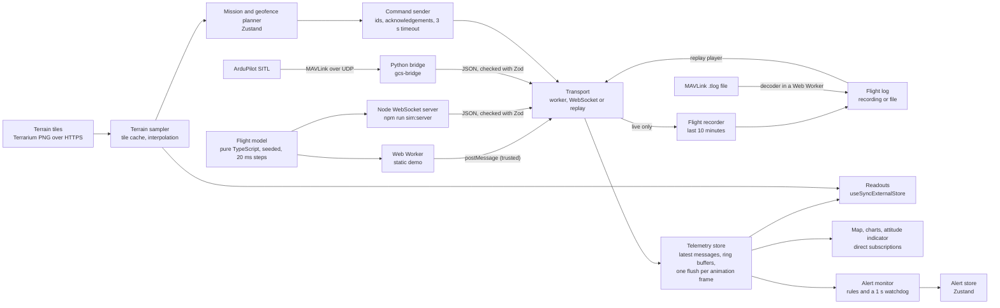
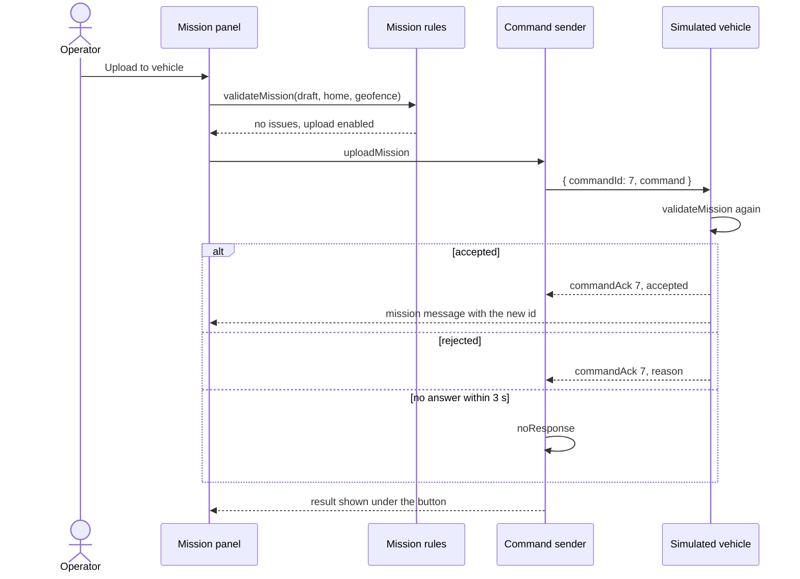
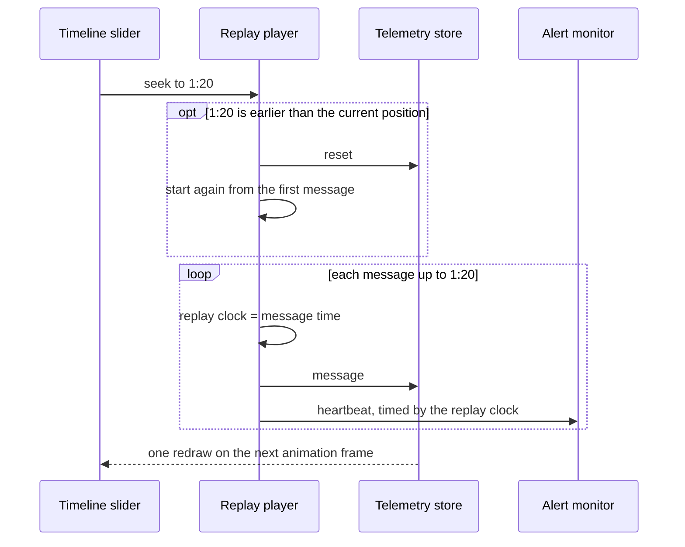
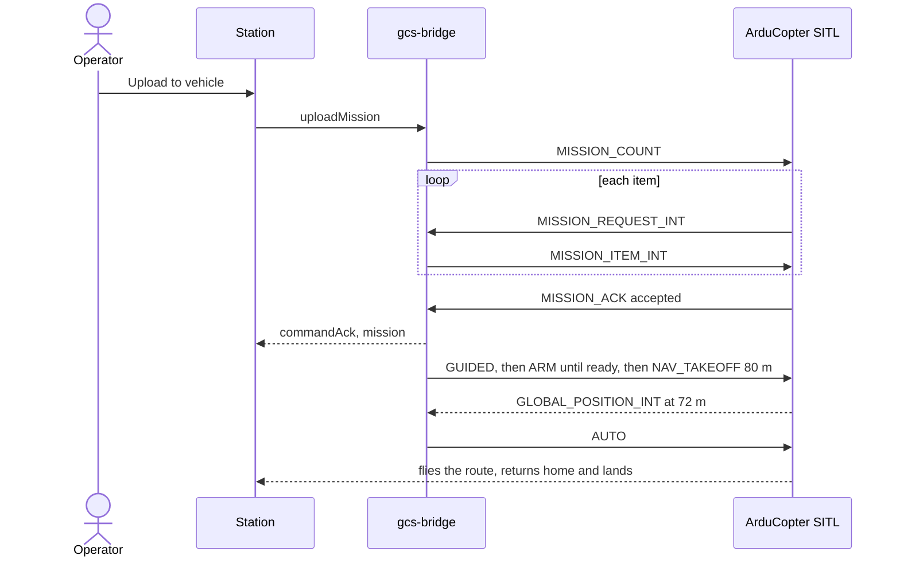

# Architecture

Mini GCS is a browser ground control station for one simulated quadcopter. This page explains how the pieces fit together and why they are built this way.

The station speaks its own protocol, loosely modelled on MAVLink. It reaches real MAVLink in two places: it replays ArduPilot telemetry logs (`.tlog`) with its own decoder, and a Python bridge connects it to ArduPilot SITL, the official ArduPilot simulator. All flights are simulated.

## Data flow

| Module                  | Folder                                   | Responsibility                                                                   |
| ----------------------- | ---------------------------------------- | -------------------------------------------------------------------------------- |
| Flight model            | `src/simulator`                          | Physics, flight modes, missions, geofence, faults. No DOM, no timers.            |
| Simulation loop         | `src/simulator`                          | Steps the model every 20 ms and hands out messages. Shared by worker and server. |
| Simulator server        | `server`                                 | Streams telemetry to every station, answers each command to its sender only.     |
| Protocol                | `src/protocol`                           | Zod schemas; TypeScript types are inferred from them.                            |
| Transports              | `src/transport`                          | Worker and WebSocket transports behind one interface; reconnect with backoff.    |
| Ground station          | `src/station`                            | Wires a transport to the telemetry store and sends commands.                     |
| Telemetry store         | `src/telemetry`                          | Latest message of each type, position and status history, frame batching.        |
| Planning                | `src/planning`                           | Mission and geofence drafts, editing, upload state.                              |
| Mission rules           | `src/mission`                            | Validation shared by the station and the vehicle.                                |
| Alerts                  | `src/alerts`                             | Alert rules, reconciliation and the watchdog.                                    |
| Recording and replay    | `src/replay`                             | Flight recorder, log files, the replay player and its controls.                  |
| MAVLink                 | `src/mavlink`                            | MAVLink 1 and 2 decoder, `.tlog` reader and the translator to station messages.  |
| ArduPilot bridge        | `bridge`                                 | Python: MAVLink to ArduPilot over UDP, the station protocol over a WebSocket.    |
| Sessions                | `src/session`                            | Whether the screen shows the live vehicle or a replay, and switching between.    |
| Languages               | `src/i18n`                               | English and Ukrainian dictionaries, the chosen language and how it is picked.    |
| Terrain                 | `src/terrain`                            | Terrain tiles, elevation sampling, altitudes and route profiles.                 |
| Coordinates             | `src/geo`                                | Distances, bearings, point-in-polygon and MGRS references.                       |
| Map, charts, instrument | `src/map`, `src/charts`, `src/telemetry` | Rendering that bypasses React for high-rate data.                                |

## Protocol

Messages are loosely modelled on MAVLink: each type has its own rate, plus a sequence number and simulation time. The TypeScript types are inferred from Zod schemas, so one definition describes the protocol and validates untrusted data at runtime.

| Message          | Rate      | Contents                                                       |
| ---------------- | --------- | -------------------------------------------------------------- |
| `heartbeat`      | 1 Hz      | flight mode (the simulator's or ArduCopter's), armed state     |
| `position`       | 10 Hz     | latitude, longitude, altitude above home, speed, heading       |
| `attitude`       | 50 Hz     | roll, pitch, yaw                                               |
| `systemStatus`   | 2 Hz      | battery, GPS fix and satellites, link quality, geofence breach |
| `home`           | 0.2 Hz    | home position                                                  |
| `mission`        | 0.2 Hz    | id and waypoints of the mission on the vehicle                 |
| `missionCurrent` | 1 Hz      | waypoint the vehicle is flying to                              |
| `geofence`       | 0.2 Hz    | geofence polygon on the vehicle, or none                       |
| `commandAck`     | on demand | whether a command was accepted, and why not                    |

Commands from the station: `uploadMission`, `uploadGeofence`, `clearGeofence` and `ping` for the vehicle, and `simulateFault` for the simulator itself. `mission` and `geofence` are also sent right after a change.

## Keeping 50 Hz telemetry smooth

The attitude message arrives 50 times a second and positions 10 times a second. Re-rendering React on every message would waste most of the frame budget, so the station:

1. **Keeps telemetry outside React.** The store holds the latest message of each type and ring buffers of the last 1200 positions and 240 status reports. Memory stays bounded however long the station runs.
2. **Publishes once per animation frame.** Messages update a working copy; a `requestAnimationFrame` callback publishes an immutable snapshot and notifies subscribers once. When the tab is hidden, nothing is rendered and nothing piles up.
3. **Lets each readout select exactly what it shows.** A readout's selector returns the formatted text, for example `"40.0"`, so `useSyncExternalStore` re-renders it only when that text changes.
4. **Bypasses React for animation.** The map, the charts and the attitude indicator subscribe to the store directly and update MapLibre sources, uPlot data or SVG `transform` attributes.

## A command round trip

The station checks a plan before upload so the operator sees problems early, but the vehicle checks it again and has the final say. If the draft changes while an upload is pending, the late answer is ignored, because it no longer describes the draft on screen.

## The simulated vehicle

- Guidance turns at most 60°/s, accelerates at 2 m/s² and brakes with `v = √(2·a·d)` so it stops at home.
- Roll is the bank angle a turn needs, `atan(v·ω/g)`. Pitch leans forward to accelerate and against drag, both limited to 35°.
- Noise comes from a seeded generator, so a test with a fixed seed always sees the same flight.
- Faults are injected on purpose: a 10 s link loss drops every message and vehicle command, a GPS loss leaves two satellites for 15 s, a battery drop sets the charge to 32%.

## Recording and replay

While the station is live, a flight recorder keeps every telemetry message from the last 10 minutes, about 39,000 messages. Older messages are dropped as new ones arrive, and the recording starts over when message time goes back, which means the simulator restarted. The operator can replay the recording, download it as a JSON file, or open a file saved earlier.

**A replay is just another transport.** The replay player implements the same `Transport` interface as the worker and the WebSocket, and a replay session builds an ordinary ground station on top of it. The telemetry store, the map, the charts, the readouts and the alert monitor do not know whether they are showing a live vehicle or a recording.

**Seeking rebuilds the state from the log.** The player keeps an index into the sorted messages. Playing forward delivers the messages whose time has come. Seeking forward delivers the skipped ones. Seeking back resets the telemetry store and delivers everything from the start up to the new position, which takes a few milliseconds for a 10 minute log.

**Alerts run on replay time.** The alert monitor takes its clock from the player instead of `performance.now()`. Pausing a replay therefore does not raise a link loss alert, and a link loss in the recording raises the alert at the moment it happened, at any playback speed.

- **One session on screen at a time.** Starting a replay disconnects the live link, as QGroundControl does, and `Back to live` connects again. The app remounts for each session; the alert and latency monitors clear their stores when they stop, so nothing carries over.
- **No commands during a replay.** The vehicle controls are hidden, and the replay transport answers any command with a rejection.
- **Playback follows animation frames.** A hidden tab gets no frames, so the replay simply pauses; each frame advances at most 250 ms, so returning to the tab does not jump ahead.
- **Log files** hold a format name, a version, the save time and the messages. The parser, with Zod, loads only when a file is opened.
- **The timeline** shows flight modes from heartbeats and marks gaps longer than the link loss timeout as a lost link.

## MAVLink logs

The station opens `.tlog` files, the telemetry logs that Mission Planner, QGroundControl and the bridge write, and replays them like its own recordings. A `.tlog` is a sequence of records, each an 8-byte big-endian timestamp in microseconds followed by one MAVLink frame. The file is parsed in a Web Worker, so a large log does not freeze the page.

- **The decoder** reads MAVLink 1 and 2 frames, checks the X.25 checksum with each message's `CRC_EXTRA`, zero-fills MAVLink 2 payloads that were truncated on the wire, and skips the 13-byte signature of signed frames. It knows the 12 messages the station needs; other frames are skipped by their length without being decoded.
- **Damaged bytes do not stop the reader.** When a record does not start with a plausible timestamp and a valid frame, the reader moves on one byte at a time until it finds the next one, and counts what it skipped.
- **The translator** turns ArduPilot messages into station messages: `HEARTBEAT` into the flight mode and armed state, `GLOBAL_POSITION_INT` into position, `ATTITUDE` from radians into degrees, and `SYS_STATUS`, `GPS_RAW_INT` and `FENCE_STATUS` into one system status. It ignores the zero position an autopilot sends before it has a GPS fix.
- **Missions and geofences are rebuilt from transfers.** A log does not contain "the mission"; it contains the mission protocol. The translator follows `MISSION_COUNT` and `MISSION_ITEM_INT` in either direction and keeps the plan only when the other side answers with an accepted `MISSION_ACK`, so a rejected or incomplete upload never shows up.
- **Link quality comes from sequence numbers.** Every MAVLink frame carries an 8-bit counter; gaps over the last 2 s give the share of frames that were lost, the way QGroundControl estimates it.
- **The tests use frames encoded by pymavlink**, the reference MAVLink implementation. A script in `bridge/scripts` writes them, so the decoder is checked against an independent encoder instead of against itself.

## Flying ArduPilot SITL

`gcs-bridge` is a Python program between ArduPilot SITL and the station. It speaks MAVLink to the autopilot over UDP and the station's own protocol over a WebSocket, so the station flies a real autopilot through the same WebSocket transport it uses for the Node simulator. Details and setup are in [bridge/README.md](../bridge/README.md).

- **A station route becomes an ArduCopter mission:** home, a takeoff, the waypoints and a return to launch. A lost message is sent again, and a rejection such as `MAV_MISSION_INVALID_SEQUENCE` reaches the operator as the reason.
- **ArduCopter decides when it is ready.** Its pre-arm flag in `SYS_STATUS` passes in STABILIZE before the EKF has a position, and a non-zero `GLOBAL_POSITION_INT` appears when the EKF sets its origin, about 20 s before it uses GPS. Arming in GUIDED and enabling a geofence fail until then. The bridge therefore waits for `EKF_STATUS_REPORT` to show an absolute horizontal position, retries arming until the autopilot agrees, and logs the autopilot's `STATUSTEXT` messages. Both quirks were found by flying SITL, not by the fake autopilot in the tests.
- **Commands run concurrently, changes to the vehicle do not.** A ping does not wait behind an upload, but uploads, mode changes and parameter writes take one lock, so two MAVLink exchanges never interleave.
- **Ping is a `TIMESYNC` round trip** to the autopilot, so the latency readout includes the whole path, not just the WebSocket.
- **The simulator controls map to SITL:** link loss holds back the bridge's traffic for 10 s, GPS loss sets `SIM_GPS1_ENABLE` to 0 for 15 s, and the battery drop uses `MAV_CMD_BATTERY_RESET`.

## One protocol, two languages

The Zod schemas in `src/protocol` are the single source of truth. `npm run protocol:schema` exports them as JSON Schema to `bridge/contract`, a station test fails when the committed file is out of date, and the bridge's tests check every message it sends against that file. The bridge's pydantic models for incoming commands are checked to cover the same command types. Changing the protocol on one side without the other fails CI.

## Terrain and coordinates

The station knows the ground under the vehicle and under a planned route. The heights come from Terrain Tiles, an open elevation dataset on AWS that serves PNG tiles in the Terrarium encoding, where a pixel's height is `R·256 + G + B/256 − 32768` metres. Around the demo area the data comes from EU-DEM, with about 25 to 30 m between samples.

- **An own sampler for numbers, the map only for pictures.** The terrain sampler loads tiles at zoom 13, about 14 m per pixel here, decodes them in a canvas, interpolates between the four nearest pixel centres and keeps the tiles in a cache. A tile that fails is tried again after 30 s. Components read heights through a React context and re-render when a tile arrives. MapLibre can also report terrain heights, but only where the map has drawn tiles and only while it exists; the sampler gives the same answer in the telemetry panel, the planner and the tests.
- **Three altitudes.** The vehicle reports its altitude above home, as autopilots do. Above sea level adds the terrain height at home; above the ground subtracts the terrain under the vehicle.
- **The route profile** samples the ground every 20 m along straight legs from home through the waypoints and back, against the mission altitude, and names the lowest clearance and its leg. Below 20 m, or when the route runs into a slope, the text becomes a warning. It does not block the upload: the vehicle does not know the terrain, and the operator decides.
- **The terrain found a bug.** Missions used to fly 40 m above home, and the demo patrol crosses a slope 41 m higher than home, so the simulated vehicle flew through the hillside. Missions now fly at 80 m, a constant shared by the station, the simulator and the bridge.
- **On the map**, a hillshade sits under roads, water and labels. The 3D view raises the terrain with 1.5 times exaggeration for the eye; the numbers never use it.
- **Coordinates.** A readout follows the cursor with latitude and longitude, the MGRS reference and the ground elevation. Clicking the map outside drawing marks a point and opens a card with copy buttons and the distance and bearing from home and from the vehicle. MGRS references come from the `mgrs` library of the proj4js project, to the metre.

## Languages

The interface is available in English and Ukrainian.

- **The English dictionary is the contract.** `en.ts` is a plain object whose type becomes `Messages`, and `uk.ts` must have the same shape, so a missing key fails type-checking. Phrases with numbers are functions, and Ukrainian plural forms such as "1 точка, 2 точки, 5 точок" come from `Intl.PluralRules`.
- **Logic returns codes, the interface chooses the words.** Mission rules, alert rules, upload results and flight log errors return codes such as `waypointOutsideGeofence`, and components describe them with the current dictionary. The simulator describes its rejections in English, like a real autopilot, and the station shows them as received.
- **Picking the language.** The `?lang=` parameter comes first, then the saved choice, then the browser languages, then English. A choice is saved in local storage, sets `<html lang>` and keeps an existing `lang` parameter in step, so a reload or a shared link shows the same language.
- **Imperative views follow along.** MapLibre reads its control labels only when a map is created, so the map is recreated on a switch and keeps its camera; charts rebuild from the telemetry history.
- **What stays the same.** Flight modes such as AUTO and RTL are autopilot mode names and are not translated. Numbers keep a decimal point in both languages, so coordinates stay unambiguous; units are translated.

## Trust boundaries

| Source                          | Trusted? | What happens                                                                                   |
| ------------------------------- | -------- | ---------------------------------------------------------------------------------------------- |
| Web Worker messages             | Yes      | Same origin and same build as the page, used as they are.                                      |
| WebSocket messages              | No       | Parsed and checked against the Zod schemas; anything else is dropped.                          |
| Commands arriving at the server | No       | Checked the same way; malformed commands are ignored.                                          |
| Opened flight log files         | No       | Up to 50 MB and 200,000 messages, checked against the Zod schemas.                             |
| Opened `.tlog` files            | No       | Up to 50 MB, frames checked by checksum, parsed in a Web Worker.                               |
| Commands arriving at the bridge | No       | Checked with pydantic; pages from unknown origins are refused.                                 |
| `?server=` parameter            | No       | Only `ws:` and `wss:` addresses are used.                                                      |
| `?lang=` and the saved language | No       | Only `en` and `uk` are used; anything else falls back.                                         |
| Terrain tiles                   | No       | Decoded only into heights; a failed request or a tile of the wrong size means no terrain data. |

The simulator server and the bridge listen on `127.0.0.1` only. The Node simulator server does not check the `Origin` header, so any page open in the same browser could connect to it; that is acceptable for a local simulator. The bridge commands an autopilot, so it accepts only the station's own origins and clients without an `Origin` header.

## Testing

| Layer         | Tool                              | What it covers                                                                                                           |
| ------------- | --------------------------------- | ------------------------------------------------------------------------------------------------------------------------ |
| Logic         | Vitest                            | Geometry, MGRS, simulator flights with fixed seeds, stores, rules, backoff, protocol, terrain sampling, route profiles.  |
| Components    | React Testing Library (jsdom)     | Panels and controls through roles and accessible names, in both languages.                                               |
| Server        | Vitest (Node)                     | A real WebSocket server on a random port with real clients.                                                              |
| End to end    | Playwright with the system Chrome | Map editing, uploads, geofence breach, alerts, reconnect, replay, languages, terrain from a stub tile.                   |
| Accessibility | axe with Playwright               | WCAG 2.2 AA on every tab, with an alert, in a replay, drawing in Ukrainian, and with a point card and a terrain profile. |
| MAVLink       | Vitest with pymavlink fixtures    | Frames, checksums, truncation, signing, damaged logs, mission transfers.                                                 |
| Bridge        | pytest, ruff, mypy (strict)       | A fake ArduCopter over real UDP and a real WebSocket client, no SITL needed.                                             |
| Contract      | JSON Schema from Zod              | Every message the bridge sends is valid for the station.                                                                 |

MapLibre and uPlot need WebGL and canvas, which jsdom lacks, so their React wrappers are mocked in component tests and exercised in Playwright instead. The logic they rely on, such as GeoJSON builders and chart windows, has its own unit tests. Decoding a terrain tile needs a real canvas too, so component tests use a fake terrain and Playwright serves a flat tile built with pngjs, which keeps the end-to-end tests off the network for terrain and gives exact altitudes.

## Decisions and trade-offs

- **Custom telemetry store and Zustand side by side.** Telemetry changes many times per frame and needs batching and history; planning and alerts change on clicks and fit Zustand's simple model.
- **Worker by default, WebSocket on request.** The worker keeps the demo working on static hosting. The WebSocket mode shows the same client against a separate process, with reconnect.
- **Reconnect only for WebSocket.** In worker mode there is no network that can drop, and restarting the worker would start a new flight.
- **Lazy loading.** MapLibre, uPlot, and Zod with the WebSocket transport or the flight log parser load only when needed; the initial bundle is about 80 KB gzipped.
- **Replay as a transport.** Replay reuses the whole station instead of a second set of components, and the player is tested on its own with a fake clock and fake frames.
- **Rebuilding instead of snapshots.** Seeking back replays the log from the start. Periodic snapshots of the telemetry store would make long logs faster to seek, at the cost of more code and memory; 10 minutes does not need them.
- **Own dictionaries instead of an i18n library.** For two languages and about 150 strings, typed objects give compile-time checks with no dependency. With translators, many languages or ICU message files, i18next or FormatJS would pay off.
- **Mermaid instead of images.** Diagrams live as text next to the code, so they show up in diffs and are easy to keep current.
- **The bridge translates, the station stays MAVLink-free.** The browser keeps one protocol and one set of transports; MAVLink details, retries and ArduPilot quirks live in one Python process. The cost is that the station can only use what its protocol describes.
- **Python for the bridge.** pymavlink is the reference MAVLink implementation and most ArduPilot tooling is Python, so the bridge uses the same codec as MAVProxy instead of a port.
- **An own decoder in the browser.** Replaying logs needs 12 messages; a small decoder keeps the bundle light, works in a Web Worker and is checked against pymavlink.
- **An own terrain sampler instead of the map's terrain.** The map's terrain heights depend on what it has drawn; the sampler gives the same height wherever it is asked, is a few dozen lines and runs in unit tests. MGRS, with its zones, bands and 100 km squares, comes from a small, well tested library instead.
- **One mission altitude.** The station's profile, the simulator and the bridge all use 80 m above home. The protocol does not carry altitudes, so they are kept in step by a shared constant in TypeScript and the bridge's default.

## Known limitations

- Point-in-polygon math works on latitude and longitude as a flat plane. That is accurate for an area a few kilometres across, not across the antimeridian or near the poles.
- A geofence checks waypoints, not the legs between them, so a concave fence can still be crossed; the vehicle then returns home.
- Self-intersecting geofences are not rejected.
- A WebSocket that stays open but stops delivering data only raises the link loss alert; the station reconnects once the socket closes.
- After the server restarts, the trail is not cleared, so it jumps to the new flight.
- The recording lives in memory only. Reloading the page loses it unless it was downloaded, and in worker mode going back to live starts a new flight and a new recording.
- Seeking back in a log much longer than 10 minutes gets slower, because it replays from the start.
- The file picker button is drawn by the browser, so it follows the browser's language rather than the station's.
- A `.tlog` from an autopilot without a battery monitor shows the battery as 100%, because the protocol has no "unknown" battery level.
- The bridge launches a mission only from the ground when a mission is uploaded; after landing, the next upload flies again. There is no manual control.
- The simulator controls of the bridge set SITL parameters and do not work on a real autopilot.
- The terrain is a 25 to 30 m model of the ground without trees or buildings, so the profile keeps a 20 m margin and is a planning aid, not obstacle avoidance.
- Altitude above sea level is the terrain height at home plus the altitude above home, not the GPS altitude, so it can differ from the autopilot's by a few metres.
- The simulator and the bridge fly at a fixed altitude above home and do not follow the terrain.
