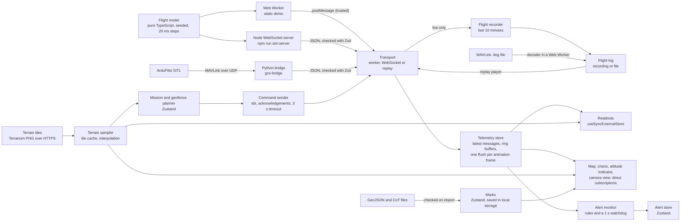
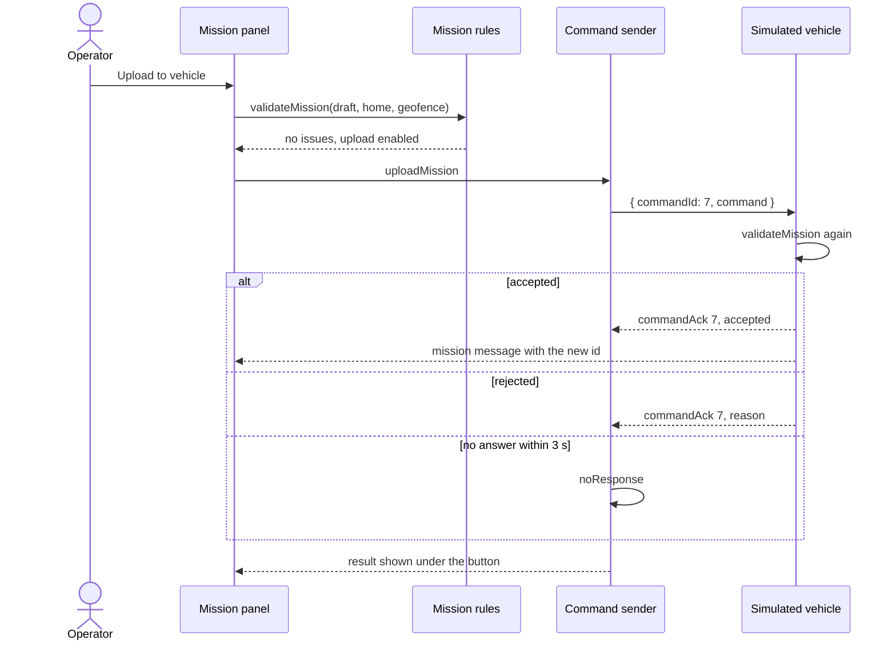
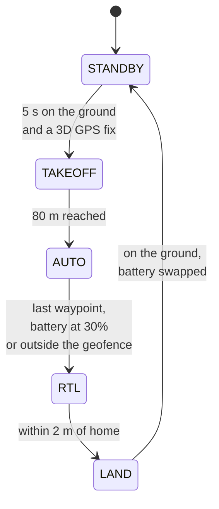
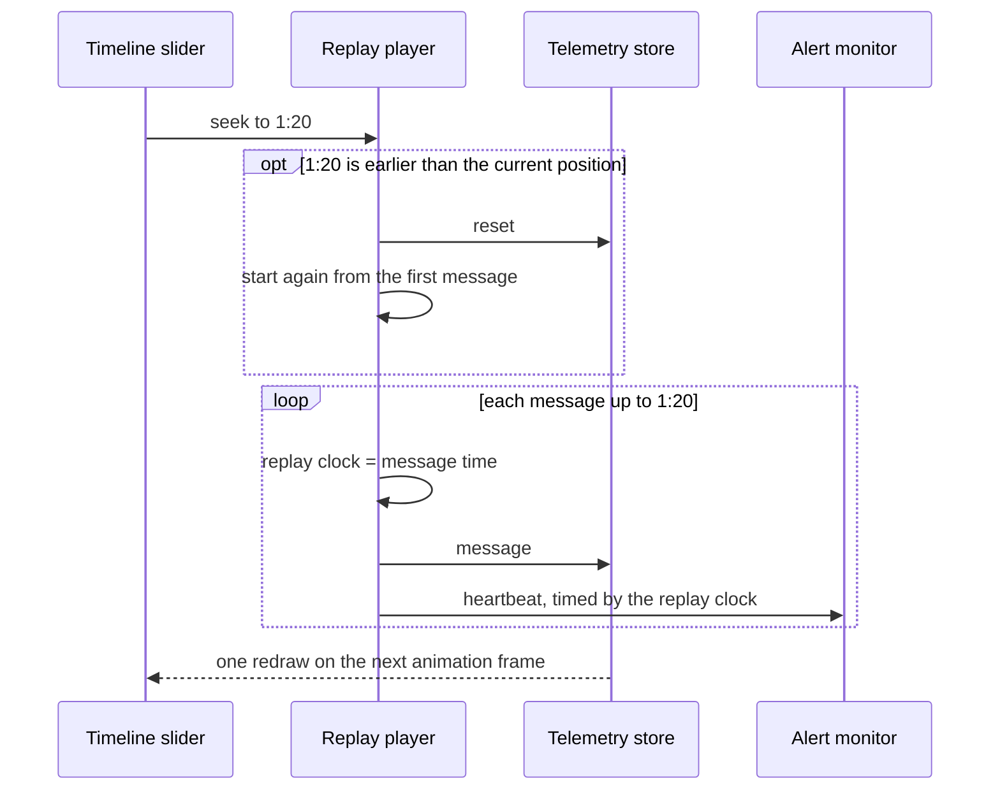
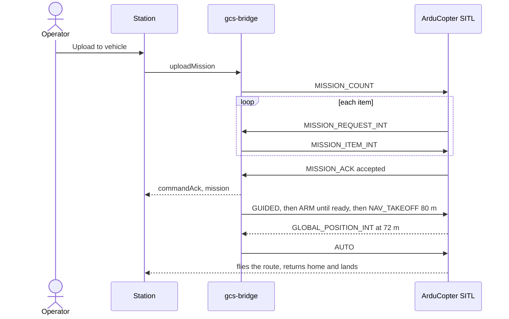
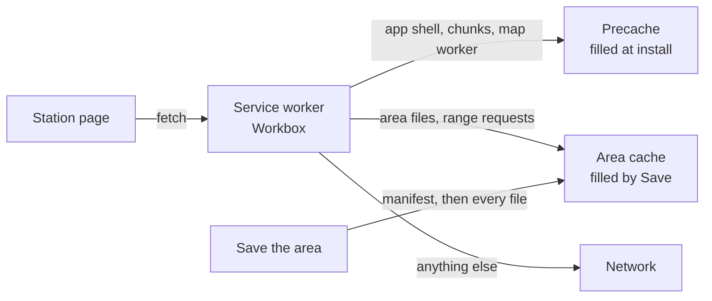

# Architecture

Mini GCS is a browser ground control station for one simulated quadcopter. This page explains how the pieces fit together and why they are built this way.

The station speaks its own protocol, loosely modelled on MAVLink. It reaches real MAVLink in two places: it replays ArduPilot telemetry logs (`.tlog`) with its own decoder, and a Python bridge connects it to ArduPilot SITL, the official ArduPilot simulator. All flights are simulated.

## Data flow

| Module                  | Folder                                   | Responsibility                                                                   |
| ----------------------- | ---------------------------------------- | -------------------------------------------------------------------------------- |
| Flight model            | `src/simulator`                          | Physics, flight modes, missions, geofence, faults. No DOM, no timers.            |
| Simulation loop         | `src/simulator`                          | Steps the model every 20 ms and hands out messages. Shared by worker and server. |
| Simulator server        | `server`                                 | Streams telemetry to every station, answers each command to its sender only.     |
| Protocol                | `src/protocol`                           | Zod schemas; TypeScript types are inferred from them.                            |
| Transports              | `src/transport`                          | Worker and WebSocket transports behind one interface; reconnect with backoff.    |
| Ground station          | `src/station`                            | Wires a transport to the telemetry store and sends commands.                     |
| Telemetry store         | `src/telemetry`                          | Latest message of each type, position and status history, frame batching.        |
| Planning                | `src/planning`                           | Mission and geofence drafts, editing, upload state.                              |
| Mission rules           | `src/mission`                            | Validation shared by the station and the vehicle.                                |
| Alerts                  | `src/alerts`                             | Alert rules, reconciliation and the watchdog.                                    |
| Recording and replay    | `src/replay`                             | Flight recorder, log files, the replay player and its controls.                  |
| MAVLink                 | `src/mavlink`                            | MAVLink 1 and 2 decoder, `.tlog` reader and the translator to station messages.  |
| ArduPilot bridge        | `bridge`                                 | Python: MAVLink to ArduPilot over UDP, the station protocol over a WebSocket.    |
| Sessions                | `src/session`                            | Whether the screen shows the live vehicle or a replay, and switching between.    |
| Languages               | `src/i18n`                               | English and Ukrainian dictionaries, the chosen language and how it is picked.    |
| Terrain                 | `src/terrain`                            | Terrain tiles, elevation sampling, altitudes and route profiles.                 |
| Coordinates             | `src/geo`                                | Distances, bearings, point-in-polygon and MGRS references.                       |
| Camera                  | `src/camera`                             | Camera geometry on the terrain, the synthetic view, its HUD and controls.        |
| Marks                   | `src/marks`                              | Map marks with APP-6 symbols, their storage, GeoJSON and Cursor on Target files. |
| Map, charts, instrument | `src/map`, `src/charts`, `src/telemetry` | Rendering that bypasses React for high-rate data.                                |

## Protocol

Messages are loosely modelled on MAVLink: each type has its own rate, plus a sequence number and simulation time. The TypeScript types are inferred from Zod schemas, so one definition describes the protocol and validates untrusted data at runtime.

| Message          | Rate      | Contents                                                         |
| ---------------- | --------- | ---------------------------------------------------------------- |
| `heartbeat`      | 1 Hz      | flight mode (the simulator's or ArduCopter's), armed state       |
| `position`       | 10 Hz     | latitude, longitude, altitude above home, speed, heading         |
| `attitude`       | 50 Hz     | roll, pitch, yaw                                                 |
| `systemStatus`   | 2 Hz      | battery, GPS fix and satellites, link quality, geofence breach   |
| `home`           | 0.2 Hz    | home position                                                    |
| `mission`        | 0.2 Hz    | id and waypoints of the mission on the vehicle                   |
| `missionCurrent` | 1 Hz      | waypoint the vehicle is flying to                                |
| `geofence`       | 0.2 Hz    | geofence polygon on the vehicle, or none                         |
| `camera`         | 10 Hz     | gimbal tilt and pan, zoom, fields of view, the point it looks at |
| `commandAck`     | on demand | whether a command was accepted, and why not                      |

Commands from the station: `uploadMission`, `uploadGeofence`, `clearGeofence`, `pointCamera`, `lookAtPoint`, `zoomCamera` and `ping` for the vehicle, and `simulateFault` for the simulator itself. `mission` and `geofence` are also sent right after a change.

## Keeping 50 Hz telemetry smooth

The attitude message arrives 50 times a second and positions 10 times a second. Re-rendering React on every message would waste most of the frame budget, so the station:

1. **Keeps telemetry outside React.** The store holds the latest message of each type and ring buffers of the last 1200 positions and 240 status reports. Memory stays bounded however long the station runs.
2. **Publishes once per animation frame.** Messages update a working copy; a `requestAnimationFrame` callback publishes an immutable snapshot and notifies subscribers once. When the tab is hidden, nothing is rendered and nothing piles up.
3. **Lets each readout select exactly what it shows.** A readout's selector returns the formatted text, for example `"40.0"`, so `useSyncExternalStore` re-renders it only when that text changes.
4. **Bypasses React for animation.** The map, the charts and the attitude indicator subscribe to the store directly and update MapLibre sources, uPlot data or SVG `transform` attributes.

## A command round trip

The station checks a plan before upload so the operator sees problems early, but the vehicle checks it again and has the final say. If the draft changes while an upload is pending, the late answer is ignored, because it no longer describes the draft on screen.

## The simulated vehicle

- Guidance turns at most 60°/s, accelerates at 2 m/s² and brakes with `v = √(2·a·d)` so it stops at home.
- Roll is the bank angle a turn needs, `atan(v·ω/g)`. Pitch leans forward to accelerate and against drag, both limited to 35°.
- Noise comes from a seeded generator, so a test with a fixed seed always sees the same flight.
- Faults are injected on purpose: a 10 s link loss drops every message and vehicle command, a GPS loss leaves two satellites for 15 s, a battery drop sets the charge to 32%.
- The camera sits on a stabilised gimbal: its tilt is measured from the horizon, its pan from the vehicle heading, and it turns at most 90°/s. Its lens zooms from ×1 to ×8 by at most two stops a second. Looking at a point, it aims at the point's height above home, which the station sends from the terrain.

## Recording and replay

While the station is live, a flight recorder keeps every telemetry message from the last 10 minutes, about 39,000 messages. Older messages are dropped as new ones arrive, and the recording starts over when message time goes back, which means the simulator restarted. The operator can replay the recording, download it as a JSON file, or open a file saved earlier.

**A replay is just another transport.** The replay player implements the same `Transport` interface as the worker and the WebSocket, and a replay session builds an ordinary ground station on top of it. The telemetry store, the map, the charts, the readouts and the alert monitor do not know whether they are showing a live vehicle or a recording.

**Seeking rebuilds the state from the log.** The player keeps an index into the sorted messages. Playing forward delivers the messages whose time has come. Seeking forward delivers the skipped ones. Seeking back resets the telemetry store and delivers everything from the start up to the new position, which takes a few milliseconds for a 10 minute log.

**Alerts run on replay time.** The alert monitor takes its clock from the player instead of `performance.now()`. Pausing a replay therefore does not raise a link loss alert, and a link loss in the recording raises the alert at the moment it happened, at any playback speed.

- **One session on screen at a time.** Starting a replay disconnects the live link, as QGroundControl does, and `Back to live` connects again. The app remounts for each session; the alert and latency monitors clear their stores when they stop, so nothing carries over.
- **No commands during a replay.** The vehicle controls are hidden, and the replay transport answers any command with a rejection.
- **Playback follows animation frames.** A hidden tab gets no frames, so the replay simply pauses; each frame advances at most 250 ms, so returning to the tab does not jump ahead.
- **Log files** hold a format name, a version, the save time and the messages. The parser, with Zod, loads only when a file is opened.
- **The timeline** shows flight modes from heartbeats and marks gaps longer than the link loss timeout as a lost link.

## MAVLink logs

The station opens `.tlog` files, the telemetry logs that Mission Planner, QGroundControl and the bridge write, and replays them like its own recordings. A `.tlog` is a sequence of records, each an 8-byte big-endian timestamp in microseconds followed by one MAVLink frame. The file is parsed in a Web Worker, so a large log does not freeze the page.

- **The decoder** reads MAVLink 1 and 2 frames, checks the X.25 checksum with each message's `CRC_EXTRA`, zero-fills MAVLink 2 payloads that were truncated on the wire, and skips the 13-byte signature of signed frames. It knows the 12 messages the station needs; other frames are skipped by their length without being decoded.
- **Damaged bytes do not stop the reader.** When a record does not start with a plausible timestamp and a valid frame, the reader moves on one byte at a time until it finds the next one, and counts what it skipped.
- **The translator** turns ArduPilot messages into station messages: `HEARTBEAT` into the flight mode and armed state, `GLOBAL_POSITION_INT` into position, `ATTITUDE` from radians into degrees, and `SYS_STATUS`, `GPS_RAW_INT` and `FENCE_STATUS` into one system status. It ignores the zero position an autopilot sends before it has a GPS fix.
- **Missions and geofences are rebuilt from transfers.** A log does not contain "the mission"; it contains the mission protocol. The translator follows `MISSION_COUNT` and `MISSION_ITEM_INT` in either direction and keeps the plan only when the other side answers with an accepted `MISSION_ACK`, so a rejected or incomplete upload never shows up.
- **Link quality comes from sequence numbers.** Every MAVLink frame carries an 8-bit counter; gaps over the last 2 s give the share of frames that were lost, the way QGroundControl estimates it.
- **The tests use frames encoded by pymavlink**, the reference MAVLink implementation. A script in `bridge/scripts` writes them, so the decoder is checked against an independent encoder instead of against itself.

## Flying ArduPilot SITL

`gcs-bridge` is a Python program between ArduPilot SITL and the station. It speaks MAVLink to the autopilot over UDP and the station's own protocol over a WebSocket, so the station flies a real autopilot through the same WebSocket transport it uses for the Node simulator. Details and setup are in [bridge/README.md](../bridge/README.md).

- **A station route becomes an ArduCopter mission:** home, a takeoff, the waypoints and a return to launch. A lost message is sent again, and a rejection such as `MAV_MISSION_INVALID_SEQUENCE` reaches the operator as the reason.
- **ArduCopter decides when it is ready.** Its pre-arm flag in `SYS_STATUS` passes in STABILIZE before the EKF has a position, and a non-zero `GLOBAL_POSITION_INT` appears when the EKF sets its origin, about 20 s before it uses GPS. Arming in GUIDED and enabling a geofence fail until then. The bridge therefore waits for `EKF_STATUS_REPORT` to show an absolute horizontal position, retries arming until the autopilot agrees, and logs the autopilot's `STATUSTEXT` messages. Both quirks were found by flying SITL, not by the fake autopilot in the tests.
- **Commands run concurrently, changes to the vehicle do not.** A ping does not wait behind an upload, but uploads, mode changes and parameter writes take one lock, so two MAVLink exchanges never interleave.
- **Ping is a `TIMESYNC` round trip** to the autopilot, so the latency readout includes the whole path, not just the WebSocket.
- **The simulator controls map to SITL:** link loss holds back the bridge's traffic for 10 s, GPS loss sets `SIM_GPS1_ENABLE` to 0 for 15 s, and the battery drop uses `MAV_CMD_BATTERY_RESET`.

## One protocol, two languages

The Zod schemas in `src/protocol` are the single source of truth. `npm run protocol:schema` exports them as JSON Schema to `bridge/contract`, a station test fails when the committed file is out of date, and the bridge's tests check every message it sends against that file. The bridge's pydantic models for incoming commands are checked to cover the same command types. Changing the protocol on one side without the other fails CI.

## Terrain and coordinates

The station knows the ground under the vehicle and under a planned route. The heights come from Terrain Tiles, an open elevation dataset on AWS that serves PNG tiles in the Terrarium encoding, where a pixel's height is `R·256 + G + B/256 − 32768` metres. Around the demo area the data comes from EU-DEM, with about 25 to 30 m between samples.

- **An own sampler for numbers, the map only for pictures.** The terrain sampler loads tiles at zoom 13, about 14 m per pixel here, decodes them in a canvas, interpolates between the four nearest pixel centres and keeps the tiles in a cache. A tile that fails is tried again after 30 s. Components read heights through a React context and re-render when a tile arrives. MapLibre can also report terrain heights, but only where the map has drawn tiles and only while it exists; the sampler gives the same answer in the telemetry panel, the planner and the tests.
- **Three altitudes.** The vehicle reports its altitude above home, as autopilots do. Above sea level adds the terrain height at home; above the ground subtracts the terrain under the vehicle.
- **The route profile** samples the ground every 20 m along straight legs from home through the waypoints and back, against the mission altitude, and names the lowest clearance and its leg. Below 20 m, or when the route runs into a slope, the text becomes a warning. It does not block the upload: the vehicle does not know the terrain, and the operator decides.
- **The terrain found a bug.** Missions used to fly 40 m above home, and the demo patrol crosses a slope 41 m higher than home, so the simulated vehicle flew through the hillside. Missions now fly at 80 m, a constant shared by the station, the simulator and the bridge.
- **On the map**, a hillshade sits under roads, water and labels. The 3D view raises the terrain with 1.5 times exaggeration for the eye; the numbers never use it.
- **Coordinates.** A readout follows the cursor with latitude and longitude, the MGRS reference and the ground elevation. Clicking the map outside drawing marks a point and opens a card with copy buttons and the distance and bearing from home and from the vehicle. MGRS references come from the `mgrs` library of the proj4js project, to the metre.

## The camera

The simulated vehicle carries a gimbal camera. The station shows where it looks on the map, draws what it would see, and lets the operator steer it. The camera message names its fields after the MISB ST 0601 sensor fields that video metadata uses: sensor relative azimuth and elevation, horizontal and vertical field of view, frame centre.

`mermaid
flowchart LR
  camera["camera message tilt, pan, zoom, fields of view"] --> pose["Camera pose position, height, azimuth, tilt"]
  position["position message"] --> pose
  pose --> ray["Ray through a frame point"]
  ray -- "10 m steps over the terrain, then bisection" --> hit["Ground point and range"]
  hit --> footprint["Footprint and line of sight on the map"]
  hit --> hud["HUD: MGRS and range of the frame centre"]
  hit --> pick["Point clicked in the view"]
  pose --> video["Synthetic view second MapLibre camera"]
`

- **One geometry for everything.** Pure functions turn the vehicle position, its heading and the gimbal angles into a ray for any point of the frame and march it over the terrain in 10 m steps, refining the hit by bisection. The footprint corners, the frame centre in the HUD and a point clicked in the view all come from the same functions, which are unit tested on flat ground, a cliff and a step. Corners that see the sky are drawn 1.5 km out.
- **The synthetic view is a second map.** A MapLibre map with the Liberty style, terrain at true scale and a sky puts its camera at the vehicle's position and altitude above sea level with `calculateCameraOptionsFromCameraLngLatAltRotation`, turned to the gimbal's bearing and tilt, with the camera's vertical field of view and a 16:9 frame. Its centre is not clamped to the ground, so the camera stays where the vehicle is. In the browser, the map's own ground point under the centre of the view closely matches the geometry's frame centre. The view is labelled as synthetic: it stands in for a video stream, which would carry the same angles as metadata.
- **Picking and pointing.** Clicking the view marks the ground point under the cursor, and Enter marks the point under the crosshair. The point card can point the camera at a selected point; the vehicle then keeps it in view while flying. Manual tilt and pan buttons move in 10° steps from the reported angles and end the tracking.
- **Zoom narrows the field of view.** The zoom divides the tangent of the half angle, not the angle: at ×8 the horizontal view is 8.5°, not 61.3° / 8, and the frame on the ground is eight times narrower. Everything else already reads the fields of view from the camera message, so the footprint, the HUD, picking and the synthetic view follow the zoom without changes. Tilt and pan steps are divided by the zoom: a 10° step at ×8 would jump past the whole frame. Zooming in does not add detail to the synthetic view, so the lens stops at ×8.
- **Two views, one of them small.** The map or the camera can fill the panel while the other sits in a small window, which a button enlarges and its corner resizes from 220 to 960 px; each view keeps its own size. Both MapLibre maps stay mounted and only their CSS changes, so a swap keeps their state and creates no new WebGL context, and MapLibre follows the new size through its ResizeObserver. As the main view, the camera frame keeps its 16:9 shape with bars around it, sized with CSS container units, because the picture, the HUD and picking all assume the camera's own frame. The resize corner is a slider for the keyboard and screen readers. While a route is being drawn, the map is always the main view.
- **Replays include the camera.** Camera messages are recorded like any other, so a replay shows the same view and footprint, without the controls.
- **The bridge does not control a camera yet.** It understands the camera commands, so the protocol stays in step, and answers that it does not support them. ArduPilot SITL can simulate a mount, which would be the next step.

## Marks

The operator places marks, points with an APP-6 military symbol, on a point picked on the map or in the camera view, and shares them with GIS tools and TAK clients such as ATAK. The demo starts with no marks.

- **A symbol is an affiliation and a function.** APP-6 draws the affiliation as the frame (a blue rectangle for a friend, a red diamond for hostile, a green square for neutral, a yellow quatrefoil for unknown) and the function as the icon inside it. The station offers the four affiliations and six functions: ground track, infantry, armour, artillery, ground vehicle and UAV. A new mark starts as an unknown ground track, the way an unidentified contact is reported.
- **One letter code for both formats.** A mark's symbol is a 15-character letter code of APP-6 B and MIL-STD-2525 C, such as `SHGPUCI--------` for hostile infantry. Cursor on Target types are spelled from the same letters: `a-h-G-U-C-I`. The function is kept as a path down the symbol tree (`U`, `C`, `I`: unit, combat, infantry), so both codes come from one table. The 20-digit numeric codes of APP-6 D would need a mapping table to CoT types.
- **milsymbol draws the symbols.** It is about 200 KB gzipped, so it loads in its own chunk the first time a symbol is shown, and a unit test checks every code the station writes with milsymbol's own validation.
- **Marks stay in the browser.** A Zustand store is saved to local storage with a format version. On load each mark is checked with Zod, and a damaged one is dropped without losing the rest. Marks belong to the operator, not to a flight: they show in live and in replay, and adding one sends nothing to the vehicle.
- **GeoJSON for GIS tools.** The export is a FeatureCollection of points in longitude, latitude order, as RFC 7946 requires, with the name, affiliation, type, symbol code and time. The import takes any GeoJSON points: each missing or wrong property falls back on its own, to an unknown ground track named "Untitled mark", and features that are not points are counted as skipped.
- **Cursor on Target for TAK.** Each mark downloads as one CoT event: its id as the `uid`, the type from its symbol, `how="h-g-i-g-o"` for a point entered by a person, a stale time 24 hours on and the name as the contact callsign. Height and errors carry CoT's unknown value `9999999.0`: the station knows the terrain height above sea level, but CoT wants the height above the WGS84 ellipsoid. The XML is built with the DOM and `XMLSerializer`, so a name with `<` or `&` cannot break it.
- **Reading CoT.** The import reads every event in a file, takes the most specific symbol the station knows for its type (`a-h-G-U-C-I-Z`, motorised infantry, becomes infantry) and folds assumed, suspect and pending identities into the four affiliations. Events that are not atoms, such as chat or routes, are skipped. The browser's DOMParser loads no external entities, so a crafted XML file cannot reach the network or the disk.
- **An id updates a mark.** Imported marks keep their GeoJSON id or CoT uid, so importing a file again updates its marks instead of adding them twice.
- **On the map** each mark is a MapLibre marker with the symbol and its name, placed by the anchor point milsymbol reports for the symbol. Clicking a mark selects its point; the list can centre the map on a mark, rename it, remove it or download it as CoT.

## Working without a network

A station in the field cannot count on the internet. The station works offline in two layers: the app itself, and the map and terrain of one area.

- **The app shell is precached.** vite-plugin-pwa generates a Workbox service worker at build time that caches the page, every chunk and the MapLibre worker, so the station opens without a network once it has been opened online. The simulator runs in a Web Worker, so a flight works offline too. The worker takes control of the open page as soon as it is installed, so saving the area and losing the network in the same visit works. A new version waits until the operator presses Reload, so the code never changes under a flight.
- **The area is saved on purpose.** The map and terrain of the demo area are about 10 MB, too much to download on every first visit over a mobile link. The operator saves them with a button that shows the size and the progress, the way field tablets load maps before a mission. Saving asks the browser for persistent storage, so the area is not evicted under storage pressure.
- **The area package** holds two PMTiles archives and a manifest of every file with its size. The map is OpenStreetMap vector data cut from a Protomaps planet build with `pmtiles extract`; the terrain is the same Terrarium tiles the station uses online, zooms 0 to 13, packed through MBTiles with `pmtiles convert`. The fonts and sprites of the Protomaps style come along. `npm run area:build` rebuilds it, and the files are committed, so builds and CI do not depend on outside servers.
- **One file, read in pieces.** A PMTiles archive is a single file with a directory of tiles, read with HTTP range requests, so no tile server is needed; GitHub Pages answers ranges with 206. A saved file sits whole in Cache Storage, and the service worker answers range requests from it with Workbox's `RangeRequestsPlugin`. An area that is not saved is read from the site, and the partial responses are not cached.
- **Choosing the source.** The station follows the browser's `online` and `offline` events. Without a network, or when the operator asks for the area map, both maps load a Protomaps style, dark for the map and light for the camera view, through the `pmtiles://` protocol, and their terrain layers read the terrain archive. The terrain sampler tries the network first and falls back to the package, so a link that is up but has no internet still gives heights, and the numbers are the same offline because the tiles are the same.

## Languages

The interface is available in English and Ukrainian.

- **The English dictionary is the contract.** `en.ts` is a plain object whose type becomes `Messages`, and `uk.ts` must have the same shape, so a missing key fails type-checking. Phrases with numbers are functions, and Ukrainian plural forms such as "1 точка, 2 точки, 5 точок" come from `Intl.PluralRules`.
- **Logic returns codes, the interface chooses the words.** Mission rules, alert rules, upload results and flight log errors return codes such as `waypointOutsideGeofence`, and components describe them with the current dictionary. The simulator describes its rejections in English, like a real autopilot, and the station shows them as received.
- **Picking the language.** The `?lang=` parameter comes first, then the saved choice, then the browser languages, then English. A choice is saved in local storage, sets `<html lang>` and keeps an existing `lang` parameter in step, so a reload or a shared link shows the same language.
- **Imperative views follow along.** MapLibre reads its control labels only when a map is created, so the map is recreated on a switch and keeps its camera; charts rebuild from the telemetry history.
- **What stays the same.** Flight modes such as AUTO and RTL are autopilot mode names and are not translated. Numbers keep a decimal point in both languages, so coordinates stay unambiguous; units are translated.

## Trust boundaries

| Source                          | Trusted? | What happens                                                                                   |
| ------------------------------- | -------- | ---------------------------------------------------------------------------------------------- |
| Web Worker messages             | Yes      | Same origin and same build as the page, used as they are.                                      |
| WebSocket messages              | No       | Parsed and checked against the Zod schemas; anything else is dropped.                          |
| Commands arriving at the server | No       | Checked the same way; malformed commands are ignored.                                          |
| Opened flight log files         | No       | Up to 50 MB and 200,000 messages, checked against the Zod schemas.                             |
| Opened `.tlog` files            | No       | Up to 50 MB, frames checked by checksum, parsed in a Web Worker.                               |
| Commands arriving at the bridge | No       | Checked with pydantic; pages from unknown origins are refused.                                 |
| `?server=` parameter            | No       | Only `ws:` and `wss:` addresses are used.                                                      |
| `?lang=` and the saved language | No       | Only `en` and `uk` are used; anything else falls back.                                         |
| Terrain tiles                   | No       | Decoded only into heights; a failed request or a tile of the wrong size means no terrain data. |
| Imported mark files             | No       | Up to 1 MB; GeoJSON checked with Zod, CoT read by DOMParser; positions range-checked.          |
| Saved marks                     | No       | Checked with Zod on load; a damaged mark is dropped.                                           |
| Area manifest                   | No       | Checked with Zod; a damaged manifest counts as an area that is not saved.                      |

The simulator server and the bridge listen on `127.0.0.1` only. The Node simulator server does not check the `Origin` header, so any page open in the same browser could connect to it; that is acceptable for a local simulator. The bridge commands an autopilot, so it accepts only the station's own origins and clients without an `Origin` header.

## Testing

| Layer         | Tool                              | What it covers                                                                                                                                                          |
| ------------- | --------------------------------- | ----------------------------------------------------------------------------------------------------------------------------------------------------------------------- |
| Logic         | Vitest                            | Geometry, MGRS, simulator flights with fixed seeds, stores, rules, backoff, protocol, terrain sampling, route profiles, camera geometry, symbol codes, GeoJSON and CoT. |
| Components    | React Testing Library (jsdom)     | Panels and controls through roles and accessible names, in both languages.                                                                                              |
| Server        | Vitest (Node)                     | A real WebSocket server on a random port with real clients.                                                                                                             |
| End to end    | Playwright with the system Chrome | Map editing, uploads, geofence breach, alerts, reconnect, replay, languages, terrain from a stub tile, the camera, marks and their files, opening without a network.    |
| Accessibility | axe with Playwright               | WCAG 2.2 AA on every tab, with an alert, in a replay, drawing in Ukrainian, with a point card and a terrain profile, and adding marks.                                  |
| MAVLink       | Vitest with pymavlink fixtures    | Frames, checksums, truncation, signing, damaged logs, mission transfers.                                                                                                |
| Bridge        | pytest, ruff, mypy (strict)       | A fake ArduCopter over real UDP and a real WebSocket client, no SITL needed.                                                                                            |
| Contract      | JSON Schema from Zod              | Every message the bridge sends is valid for the station.                                                                                                                |

MapLibre and uPlot need WebGL and canvas, which jsdom lacks, so their React wrappers are mocked in component tests and exercised in Playwright instead. The logic they rely on, such as GeoJSON builders and chart windows, has its own unit tests. Decoding a terrain tile needs a real canvas too, so component tests use a fake terrain and Playwright serves a flat tile built with pngjs, which keeps the end-to-end tests off the network for terrain and gives exact altitudes.

## Decisions and trade-offs

- **Custom telemetry store and Zustand side by side.** Telemetry changes many times per frame and needs batching and history; planning and alerts change on clicks and fit Zustand's simple model.
- **Worker by default, WebSocket on request.** The worker keeps the demo working on static hosting. The WebSocket mode shows the same client against a separate process, with reconnect.
- **Reconnect only for WebSocket.** In worker mode there is no network that can drop, and restarting the worker would start a new flight.
- **Lazy loading.** MapLibre, uPlot, milsymbol, PMTiles, and Zod with the WebSocket transport or the flight log parser load only when needed; the initial bundle is about 88 KB gzipped.
- **Replay as a transport.** Replay reuses the whole station instead of a second set of components, and the player is tested on its own with a fake clock and fake frames.
- **Rebuilding instead of snapshots.** Seeking back replays the log from the start. Periodic snapshots of the telemetry store would make long logs faster to seek, at the cost of more code and memory; 10 minutes does not need them.
- **Own dictionaries instead of an i18n library.** For two languages and about 240 strings, typed objects give compile-time checks with no dependency. With translators, many languages or ICU message files, i18next or FormatJS would pay off.
- **Mermaid instead of images.** Diagrams live as text next to the code, so they show up in diffs and are easy to keep current.
- **The bridge translates, the station stays MAVLink-free.** The browser keeps one protocol and one set of transports; MAVLink details, retries and ArduPilot quirks live in one Python process. The cost is that the station can only use what its protocol describes.
- **Python for the bridge.** pymavlink is the reference MAVLink implementation and most ArduPilot tooling is Python, so the bridge uses the same codec as MAVProxy instead of a port.
- **An own decoder in the browser.** Replaying logs needs 12 messages; a small decoder keeps the bundle light, works in a Web Worker and is checked against pymavlink.
- **A synthetic view instead of video.** A real video stream needs imagery of the area; free aerial imagery detailed enough for a camera 80 m up, under a licence that allows this use, is not available. Drawing the view from map and terrain data keeps the demo self-contained and still exercises the geometry a real video overlay needs.
- **Own ray casting instead of the view's `unproject`.** The footprint, the HUD and picking work without the second map, in tests and when the camera window is hidden, and give one answer everywhere.
- **An own terrain sampler instead of the map's terrain.** The map's terrain heights depend on what it has drawn; the sampler gives the same height wherever it is asked, is a few dozen lines and runs in unit tests. MGRS, with its zones, bands and 100 km squares, comes from a small, well tested library instead.
- **milsymbol instead of own symbols.** Four frames would be easy to draw, but icons, their placement and the details of the standards are not. milsymbol is the library web C2 tools use, and it costs nothing until the first symbol.
- **One CoT event per mark.** CoT is a message format, one event per message, and a plain `.cot` file holds one event. ATAK shares several items as a data package, a zip with a manifest; GeoJSON covers the whole list without a zip writer.
- **PMTiles instead of a folder of tiles.** One file per layer is one download, one cache entry and one thing to update, and range requests replace a tile server. The same file works from GitHub Pages and from Cache Storage.
- **A different style offline.** OpenFreeMap styles use the OpenMapTiles schema and Protomaps tiles use their own, so the offline map uses the Protomaps style and looks a little different from the online one. Bringing the online map onto Protomaps tiles would need a Protomaps API key or a tile host.
- **An explicit save instead of precaching the area.** Precaching would cost every visitor 10 MB on the first visit; a button costs one decision and shows what is stored.
- **One mission altitude.** The station's profile, the simulator and the bridge all use 80 m above home. The protocol does not carry altitudes, so they are kept in step by a shared constant in TypeScript and the bridge's default.

## Known limitations

- Point-in-polygon math works on latitude and longitude as a flat plane. That is accurate for an area a few kilometres across, not across the antimeridian or near the poles.
- A geofence checks waypoints, not the legs between them, so a concave fence can still be crossed; the vehicle then returns home.
- Self-intersecting geofences are not rejected.
- A WebSocket that stays open but stops delivering data only raises the link loss alert; the station reconnects once the socket closes.
- After the server restarts, the trail is not cleared, so it jumps to the new flight.
- The recording lives in memory only. Reloading the page loses it unless it was downloaded, and in worker mode going back to live starts a new flight and a new recording.
- Seeking back in a log much longer than 10 minutes gets slower, because it replays from the start.
- The file picker button is drawn by the browser, so it follows the browser's language rather than the station's.
- A `.tlog` from an autopilot without a battery monitor shows the battery as 100%, because the protocol has no "unknown" battery level.
- The bridge launches a mission only from the ground when a mission is uploaded; after landing, the next upload flies again. There is no manual control.
- The simulator controls of the bridge set SITL parameters and do not work on a real autopilot.
- The terrain is a 25 to 30 m model of the ground without trees or buildings, so the profile keeps a 20 m margin and is a planning aid, not obstacle avoidance.
- Altitude above sea level is the terrain height at home plus the altitude above home, not the GPS altitude, so it can differ from the autopilot's by a few metres.
- The simulator and the bridge fly at a fixed altitude above home and do not follow the terrain.
- The gimbal ignores the vehicle's roll and pitch as a stabilised one would, and zoom only narrows the synthetic view: map and terrain data have no more detail to show.
- The camera exists only in the station's simulator: the bridge rejects camera commands, and MAVLink logs carry no camera data the station reads.
- Marks are points only, without lines or areas, and live in one browser: stations share them only through files.
- A CoT type outside the station's six symbols becomes the nearest one it knows, often a plain ground track, so detail is lost on import. Data packages and KML are not read.
- Only the demo area, about 10 by 10 km, works offline. Outside it the offline map has no detail.
- The offline map is a snapshot of the day the package was built; `npm run area:build` refreshes it.
- The sample ArduPilot flight is not cached and needs a network.
