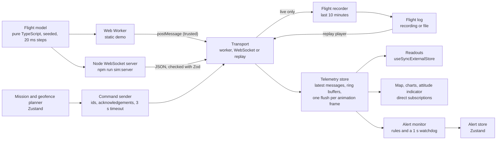
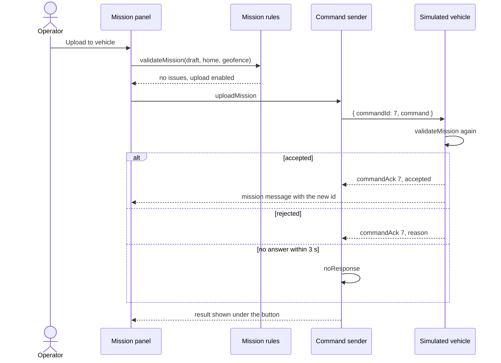
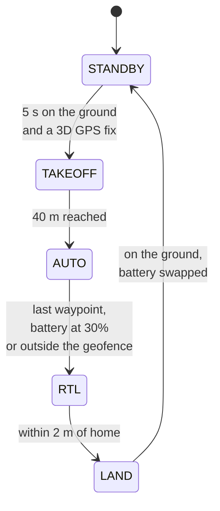
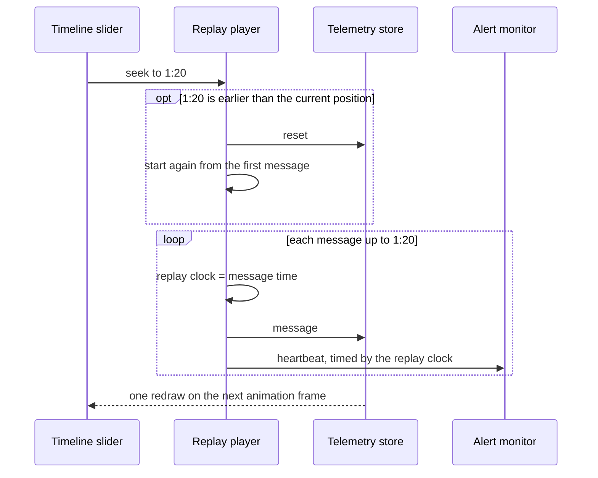

# Architecture

Mini GCS is a browser ground control station for one simulated quadcopter. This page explains how the pieces fit together and why they are built this way.

All flight data is simulated. The protocol is the project's own, loosely modelled on MAVLink, and cannot talk to real aircraft.

## Data flow

| Module                  | Folder                                   | Responsibility                                                                   |
| ----------------------- | ---------------------------------------- | -------------------------------------------------------------------------------- |
| Flight model            | `src/simulator`                          | Physics, flight modes, missions, geofence, faults. No DOM, no timers.            |
| Simulation loop         | `src/simulator`                          | Steps the model every 20 ms and hands out messages. Shared by worker and server. |
| Simulator server        | `server`                                 | Streams telemetry to every station, answers each command to its sender only.     |
| Protocol                | `src/protocol`                           | Zod schemas; TypeScript types are inferred from them.                            |
| Transports              | `src/transport`                          | Worker and WebSocket transports behind one interface; reconnect with backoff.    |
| Ground station          | `src/station`                            | Wires a transport to the telemetry store and sends commands.                     |
| Telemetry store         | `src/telemetry`                          | Latest message of each type, position and status history, frame batching.        |
| Planning                | `src/planning`                           | Mission and geofence drafts, editing, upload state.                              |
| Mission rules           | `src/mission`                            | Validation shared by the station and the vehicle.                                |
| Alerts                  | `src/alerts`                             | Alert rules, reconciliation and the watchdog.                                    |
| Recording and replay    | `src/replay`                             | Flight recorder, log files, the replay player and its controls.                  |
| Sessions                | `src/session`                            | Whether the screen shows the live vehicle or a replay, and switching between.    |
| Map, charts, instrument | `src/map`, `src/charts`, `src/telemetry` | Rendering that bypasses React for high-rate data.                                |

## Protocol

Messages are loosely modelled on MAVLink: each type has its own rate, plus a sequence number and simulation time. The TypeScript types are inferred from Zod schemas, so one definition describes the protocol and validates untrusted data at runtime.

| Message          | Rate      | Contents                                                       |
| ---------------- | --------- | -------------------------------------------------------------- |
| `heartbeat`      | 1 Hz      | flight mode, armed state                                       |
| `position`       | 10 Hz     | latitude, longitude, altitude above home, speed, heading       |
| `attitude`       | 50 Hz     | roll, pitch, yaw                                               |
| `systemStatus`   | 2 Hz      | battery, GPS fix and satellites, link quality, geofence breach |
| `home`           | 0.2 Hz    | home position                                                  |
| `mission`        | 0.2 Hz    | id and waypoints of the mission on the vehicle                 |
| `missionCurrent` | 1 Hz      | waypoint the vehicle is flying to                              |
| `geofence`       | 0.2 Hz    | geofence polygon on the vehicle, or none                       |
| `commandAck`     | on demand | whether a command was accepted, and why not                    |

Commands from the station: `uploadMission`, `uploadGeofence`, `clearGeofence` and `ping` for the vehicle, and `simulateFault` for the simulator itself. `mission` and `geofence` are also sent right after a change.

## Keeping 50 Hz telemetry smooth

The attitude message arrives 50 times a second and positions 10 times a second. Re-rendering React on every message would waste most of the frame budget, so the station:

1. **Keeps telemetry outside React.** The store holds the latest message of each type and ring buffers of the last 1200 positions and 240 status reports. Memory stays bounded however long the station runs.
2. **Publishes once per animation frame.** Messages update a working copy; a `requestAnimationFrame` callback publishes an immutable snapshot and notifies subscribers once. When the tab is hidden, nothing is rendered and nothing piles up.
3. **Lets each readout select exactly what it shows.** A readout's selector returns the formatted text, for example `"40.0"`, so `useSyncExternalStore` re-renders it only when that text changes.
4. **Bypasses React for animation.** The map, the charts and the attitude indicator subscribe to the store directly and update MapLibre sources, uPlot data or SVG `transform` attributes.

## A command round trip

The station checks a plan before upload so the operator sees problems early, but the vehicle checks it again and has the final say. If the draft changes while an upload is pending, the late answer is ignored, because it no longer describes the draft on screen.

## The simulated vehicle

- Guidance turns at most 60°/s, accelerates at 2 m/s² and brakes with `v = √(2·a·d)` so it stops at home.
- Roll is the bank angle a turn needs, `atan(v·ω/g)`. Pitch leans forward to accelerate and against drag, both limited to 35°.
- Noise comes from a seeded generator, so a test with a fixed seed always sees the same flight.
- Faults are injected on purpose: a 10 s link loss drops every message and vehicle command, a GPS loss leaves two satellites for 15 s, a battery drop sets the charge to 32%.

## Recording and replay

While the station is live, a flight recorder keeps every telemetry message from the last 10 minutes, about 39,000 messages. Older messages are dropped as new ones arrive, and the recording starts over when message time goes back, which means the simulator restarted. The operator can replay the recording, download it as a JSON file, or open a file saved earlier.

**A replay is just another transport.** The replay player implements the same `Transport` interface as the worker and the WebSocket, and a replay session builds an ordinary ground station on top of it. The telemetry store, the map, the charts, the readouts and the alert monitor do not know whether they are showing a live vehicle or a recording.

**Seeking rebuilds the state from the log.** The player keeps an index into the sorted messages. Playing forward delivers the messages whose time has come. Seeking forward delivers the skipped ones. Seeking back resets the telemetry store and delivers everything from the start up to the new position, which takes a few milliseconds for a 10 minute log.

**Alerts run on replay time.** The alert monitor takes its clock from the player instead of `performance.now()`. Pausing a replay therefore does not raise a link loss alert, and a link loss in the recording raises the alert at the moment it happened, at any playback speed.

- **One session on screen at a time.** Starting a replay disconnects the live link, as QGroundControl does, and `Back to live` connects again. The app remounts for each session; the alert and latency monitors clear their stores when they stop, so nothing carries over.
- **No commands during a replay.** The vehicle controls are hidden, and the replay transport answers any command with a rejection.
- **Playback follows animation frames.** A hidden tab gets no frames, so the replay simply pauses; each frame advances at most 250 ms, so returning to the tab does not jump ahead.
- **Log files** hold a format name, a version, the save time and the messages. The parser, with Zod, loads only when a file is opened.
- **The timeline** shows flight modes from heartbeats and marks gaps longer than the link loss timeout as a lost link.

## Trust boundaries

| Source                          | Trusted? | What happens                                                          |
| ------------------------------- | -------- | --------------------------------------------------------------------- |
| Web Worker messages             | Yes      | Same origin and same build as the page, used as they are.             |
| WebSocket messages              | No       | Parsed and checked against the Zod schemas; anything else is dropped. |
| Commands arriving at the server | No       | Checked the same way; malformed commands are ignored.                 |
| Opened flight log files         | No       | Up to 50 MB and 200,000 messages, checked against the Zod schemas.    |
| `?server=` parameter            | No       | Only `ws:` and `wss:` addresses are used.                             |

The simulator server listens on `127.0.0.1` only. It does not check the `Origin` header, so any page open in the same browser could connect to it; that is acceptable for a local simulator and would need fixing before exposing it anywhere else.

## Testing

| Layer         | Tool                              | What it covers                                                                  |
| ------------- | --------------------------------- | ------------------------------------------------------------------------------- |
| Logic         | Vitest                            | Geometry, simulator flights with fixed seeds, stores, rules, backoff, protocol. |
| Components    | React Testing Library (jsdom)     | Panels and controls through roles and accessible names.                         |
| Server        | Vitest (Node)                     | A real WebSocket server on a random port with real clients.                     |
| End to end    | Playwright with the system Chrome | Map editing, uploads, geofence breach, alerts, reconnect, replay, log files.    |
| Accessibility | axe with Playwright               | WCAG 2.2 AA checks on every control tab, with an alert raised and in a replay.  |

MapLibre and uPlot need WebGL and canvas, which jsdom lacks, so their React wrappers are mocked in component tests and exercised in Playwright instead. The logic they rely on, such as GeoJSON builders and chart windows, has its own unit tests.

## Decisions and trade-offs

- **Custom telemetry store and Zustand side by side.** Telemetry changes many times per frame and needs batching and history; planning and alerts change on clicks and fit Zustand's simple model.
- **Worker by default, WebSocket on request.** The worker keeps the demo working on static hosting. The WebSocket mode shows the same client against a separate process, with reconnect.
- **Reconnect only for WebSocket.** In worker mode there is no network that can drop, and restarting the worker would start a new flight.
- **Lazy loading.** MapLibre, uPlot, and Zod with the WebSocket transport or the flight log parser load only when needed; the initial bundle is about 80 KB gzipped.
- **Replay as a transport.** Replay reuses the whole station instead of a second set of components, and the player is tested on its own with a fake clock and fake frames.
- **Rebuilding instead of snapshots.** Seeking back replays the log from the start. Periodic snapshots of the telemetry store would make long logs faster to seek, at the cost of more code and memory; 10 minutes does not need them.
- **Mermaid instead of images.** Diagrams live as text next to the code, so they show up in diffs and are easy to keep current.

## Known limitations

- Point-in-polygon math works on latitude and longitude as a flat plane. That is accurate for an area a few kilometres across, not across the antimeridian or near the poles.
- A geofence checks waypoints, not the legs between them, so a concave fence can still be crossed; the vehicle then returns home.
- Self-intersecting geofences are not rejected.
- A WebSocket that stays open but stops delivering data only raises the link loss alert; the station reconnects once the socket closes.
- After the server restarts, the trail is not cleared, so it jumps to the new flight.
- The recording lives in memory only. Reloading the page loses it unless it was downloaded, and in worker mode going back to live starts a new flight and a new recording.
- Seeking back in a log much longer than 10 minutes gets slower, because it replays from the start.
